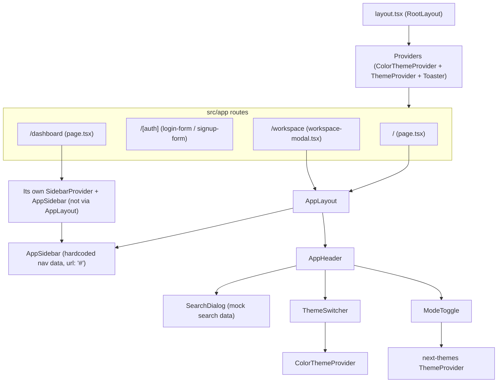

# Architecture

## System Overview

This is a Next.js (App Router) single-page frontend with no backend of its own in this repo.
Every route renders through a shared `AppLayout` (or, for the dashboard route, an inline
duplicate of the same sidebar/inset pattern) that wraps page content with a `SidebarProvider`,
`AppSidebar`, and `AppHeader`. Two context providers sit above everything in `layout.tsx`:
`ColorThemeProvider` (a custom context that toggles a `*-theme` class on `<html>`) and the
`next-themes`-based `ThemeProvider` (light/dark/system). `sonner`'s `Toaster` is mounted once at
the root and surfaced through a `useCustomToast` hook. There is no data-fetching layer, API
client usage, or state-management library in the codebase — `axios` is a listed dependency but
isn't imported anywhere in `src/`.

## Component Diagram

## Folder-by-Folder Breakdown

| Path | Contents | Notes |
|---|---|---|
| `src/app/` | Next.js App Router routes | `page.tsx` (home), `[auth]/` (dynamic login/signup route), `dashboard/`, `workspace/`, and root `layout.tsx` |
| `src/app/[auth]/` | `page.tsx`, `login-form.tsx`, `signup-form.tsx` | Single dynamic segment renders the login or signup form based on the URL; both forms are presentational only (no `onSubmit`) |
| `src/app/dashboard/` | `page.tsx` | Renders its own `SidebarProvider`/`AppSidebar` plus empty `bg-muted/50` placeholder blocks; does not reuse `AppLayout`/`AppHeader` like the other routes do |
| `src/app/workspace/` | `page.tsx`, `workspace-modal.tsx` | A dialog form for "Create Workspace" with hardcoded default input values and no submit handler |
| `src/components/layout/` | `app-layout.tsx`, `app-sidebar.tsx`, `search-form.tsx`, `header/` | The shared page shell; `app-sidebar.tsx` contains a hardcoded `data.navMain` array with `url: "#"` links; `header/app-header.tsx` has a hardcoded breadcrumb ("Building Your Application" / "Data Fetching"); `header/search-modal.tsx` implements a Ctrl/Cmd+K command palette over a hardcoded mock dataset |
| `src/components/themes/` | `mode-toggle.tsx`, `theme-switcher.tsx` | Dropdown to switch light/dark/system (via `next-themes`) and a `Select` to switch between 8 color themes (via `ColorThemeProvider`) |
| `src/components/ui/` | shadcn-ui primitives | `button`, `card`, `dialog`, `dropdown-menu`, `input`, `label`, `select`, `sidebar`, `sheet`, `skeleton`, `sonner`, `tooltip`, `breadcrumb`, `calendar`, `collapsible`, `separator` — generated via the shadcn CLI (`components.json`, style `new-york`) |
| `src/contexts/` | `providers.tsx`, `theme-context/theme-provider.tsx`, `theme-context/color-theme-provider.tsx` | `providers.tsx` composes `ColorThemeProvider` and `ThemeProvider`; `color-theme-provider.tsx` is a small custom context (not next-themes) that toggles a `*-theme` class on `document.documentElement` |
| `src/css/` | `globals.css`, `themes.css`, `themes/*.css` | Tailwind v4 entry point plus one CSS-variable file per color theme (`blue-theme.css`, `green-theme.css`, `orange-theme.css`, `red-theme.css`, `rose-theme.css`, `violet-theme.css`, `yellow-theme.css`) |
| `src/hooks/` | `use-mobile.ts` | Media-query hook used by the shadcn `sidebar` component for responsive behavior |
| `src/lib/` | `toast-util.tsx`, `utils.ts` | `useCustomToast` wraps `sonner` with theme-aware styling; `utils.ts` exports the shadcn `cn()` class-merging helper |

## Known Limitations

- **No backend or data layer.** There are no API routes, fetch/axios calls, or state-management
  library in `src/`. `axios` is declared in `package.json` but never imported.
- **Forms are not wired up.** Login, signup, and "Create Workspace" all render but have no
  `onSubmit` handler, client-side validation, or persistence — submitting does nothing.
- **Navigation is placeholder.** Every sidebar link (`src/components/layout/app-sidebar.tsx`)
  points to `url: "#"`, and the header breadcrumb (`app-header.tsx`) is hardcoded to
  "Building Your Application / Data Fetching" regardless of the current route.
- **Search is mock data.** `search-modal.tsx` filters a hardcoded array of doc-style entries and
  logs the selection to the console instead of navigating anywhere.
- **Route structure is inconsistent.** `src/app/dashboard/page.tsx` builds its own
  `SidebarProvider`/`AppSidebar` instead of using the shared `AppLayout`/`AppHeader` that every
  other route uses, so the dashboard is currently missing the header, theme switcher, and
  breadcrumb that the rest of the app has.
- **No tests or CI.** There are no test files and no `.github/workflows` (or other CI config) in
  the repo.
- **"Default" theme option has no matching CSS file.** `theme-switcher.tsx` offers a "Default"
  color theme (`default-theme`), but `src/css/themes/` only has files for the other 7 themes
  (blue, green, orange, red, rose, violet, yellow) — selecting "Default" applies a class with no
  corresponding stylesheet.
- **Leftover placeholder copy.** The sidebar header and both auth form headings reference
  "Dark Angel" (`app-sidebar.tsx`, `login-form.tsx`, `signup-form.tsx`), which doesn't match the
  app's actual name ("Project Management" per `layout.tsx`'s `<title>`); the signup form's submit
  button is also labeled "Login" instead of "Sign up" (`signup-form.tsx`).
